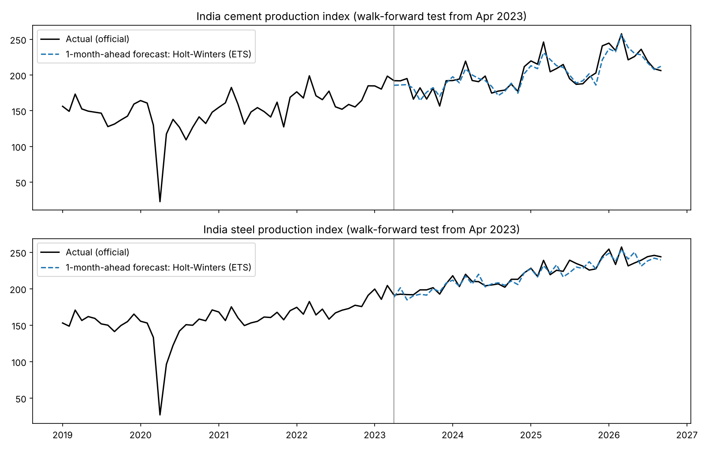
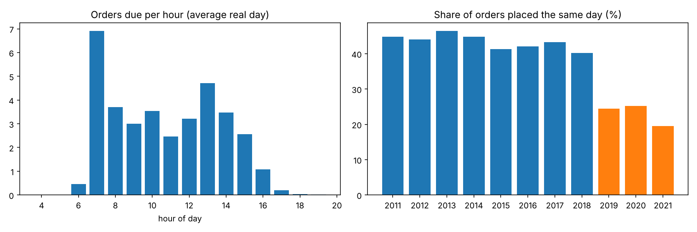

# Construction Demand Forecasting (real data)

**Forecasting demand for construction materials, and turning forecasts into supply decisions.** Everything is built on real, public data.

| Question | Answer from the data |
|---|---|
| How much cement and steel will India produce next month? | Forecast error of **3.7% (cement)** and **2.2% (steel)** over 42 unseen months, less than half the error of a "same month last year" rule |
| How many orders does a concrete supplier get on the same day? | **37%** of orders, with a median of **2.3 hours'** notice |
| How many standby trucks should be kept each morning? | A rule scaled to the morning's bookings cut estimated cost **47%** vs a fixed daily standby (validation years) |
| Does that rule keep working? | No: same-day orders fell from **43% to 24%** after 2018. A simple monitoring alarm would have caught it by **March 2019**, and retraining on the last 3 years brings the rule back below the fixed standby (−8%) |



---

## Data (all real, all public)

| Data | Source | Period | Licence |
|---|---|---|---|
| Monthly cement and steel production indices | Office of the Economic Adviser, DPIIT, Government of India, *Index of Eight Core Industries* ([download page](https://eaindustry.nic.in/ici_download_data.asp)) | Apr 2011 – Sep 2026 (186 months) | Government of India open data |
| 9,300 ready-mix concrete orders (quantity, order time, delivery time, type of work) | Tzanetos, A. & Blondin, M. (2023). *Real operational data for the Concrete Delivery Problem.* Mendeley Data, V1. [doi:10.17632/b78bc94d95.1](https://doi.org/10.17632/b78bc94d95.1) | 263 real days, 2011–2021, a producer in Quebec, Canada | CC BY 4.0 |

**Data cleaning done here**
- The government file has 51 dates stored with a wrong day (e.g. 18-Jan-2020). They are snapped to the month, and the code checks that no month is missing.
- The government changed the base year in 2026 (2011-12 → 2022-23). The two series overlap for 38 months, so the new months are linked with the average ratio. That ratio varies by only 0.2% (cement) and 1.4% (steel), so the link is safe.
- The orders come as MATLAB "table" objects (which scipy can't read). They are converted with `mat-io`.
- The 263 order days were picked by the dataset authors to cover different day sizes. **So daily totals are not used as a time series.** Only within-day patterns are analysed (same-day share, notice time, standby needs), and those don't depend on day size.

---

## Part 1: Market outlook (monthly cement and steel)

**Method**
- Forecast 1 and 3 months ahead (procurement needs lead time). Work in logs, so growth and seasonality are proportional.
- Seven models: two business baselines ("same month last year", "last year + recent growth"), Holt-Winters (ETS), SARIMA with COVID and Diwali dummies, Ridge and LightGBM on lag and calendar features, and an average of the classical models.
- **Walk-forward testing:** for each month, train only on data available at the time.
- **The model is chosen on a validation period (Apr 2021 – Mar 2023)** and scored once on the **test period (Apr 2023 – Sep 2026, 42 months)**. The test period is never used to pick the model.
- COVID: lockdown months (Apr–May 2020) and the second wave (May 2021) are handled with dummies (SARIMA) or by substituting the same month a year earlier (ETS).

**Test results (MAPE = average % error, 42 unseen months)**

| | Chosen model (Holt-Winters) | Last year + recent growth | Same month last year |
|---|---|---|---|
| Cement, 1 month ahead | **3.7%** | 4.0% | 7.8% |
| Cement, 3 months ahead | **4.1%** | 4.3% | 7.8% |
| Steel, 1 month ahead | **2.2%** | 3.5% | 8.2% |
| Steel, 3 months ahead | **2.4%** | 3.9% | 8.2% |

Full table: [`reports/market_model_comparison.csv`](reports/market_model_comparison.csv).

**What we learned**
- **Simple statistical models beat ML here.** With about 180 monthly points, LightGBM overfit (6.5% error on cement).
- **No cherry-picking.** On cement, the average of models would have scored 3.3% on test, but it scored worse on validation, so it wasn't chosen. Picking it after seeing the test results would be cheating.

---

## Part 2: Supplier operations (9,300 real orders)



- **Same-day orders:** 37% of orders (22% of volume) are placed on the day of delivery, with a median notice of 2.3 h (10% of them under 0.6 h). Same-day orders are smaller (median 5.3 m³ vs 10.5 m³).
- **Morning peak:** 19.5% of all orders are due in a single hour (7–8 am), so the morning peak sets the fleet size.
- **Standby trucks:** each morning, decide how many standby truck-loads to keep (7.5 m³ per load). Assumption: a missed load costs 3× an idle standby load. Each year is planned using only earlier years.

| Standby rule | Validation 2014–16 | Test 2017–21 |
|---|---|---|
| Same standby every day (median) | baseline | baseline |
| **Scaled to morning bookings (median)** (chosen on validation) | **−47% cost** | **+12%** ❌ |
| Scaled, newsvendor 75th percentile | −33% | +70% |
| Scaled, median, last 3 years only | −47% | **−8%** |

- **Why the chosen rule failed on test: drift.** Same-day ordering fell from 43% of orders (2011–2018) to 24% (2019–2021), so rules learned on old data kept too many trucks on standby. A control-chart alarm on the recent same-day share (3-σ below the 2011–16 level) would have fired in **March 2019**. **Lesson:** monitor the inputs and retrain on a rolling window.

---

## Dashboard

```bash
streamlit run app.py
```

- **Market outlook:** next-month forecast for cement or steel, an 80% range (from the model's real test errors) and the tested error.
- **Standby planner:** enter today's booked loads and the cost of a missed load, and get the recommended standby (newsvendor rule) plus the drift chart.

## How to run

```bash
pip install -r requirements.txt
./run_all.sh        # rebuilds every result from data/raw in about 3 minutes
streamlit run app.py
```

```
data/raw/            original files (government Excel files, Mendeley zip)
data/processed/      clean monthly series and orders table
src/01_prepare_market_data.py   clean + link the government series
src/02_market_forecast.py       7 models, walk-forward, validation/test
src/03_prepare_orders.py        MATLAB tables -> CSV
src/04_order_analytics.py       same-day orders, peak hour, standby backtest, drift
src/05_final_forecasts.py       final 3-month outlook for the dashboard
reports/             results tables, JSON headlines, figures
app.py               Streamlit dashboard
```

## Limitations and next steps
- The market data is a national production index, not one company's sales. A company would add its own orders and prices.
- Holt-Winters doesn't know that Diwali moves between October and November. Adding a calendar adjustment is the next improvement.
- The order data comes from Quebec, Canada, because comparable Indian supplier data isn't public. The method transfers; the numbers don't.
- The 3:1 cost ratio for standby trucks is an assumption. The dashboard lets the user change it.

## History
- **v1 (2025):** team prototype built during a research internship at IIT (BHU), using simulated site data (kept in `v1/`).
- **v2 (2026):** rebuilt on real data, with honest walk-forward testing, a validation/test split and decision rules.
